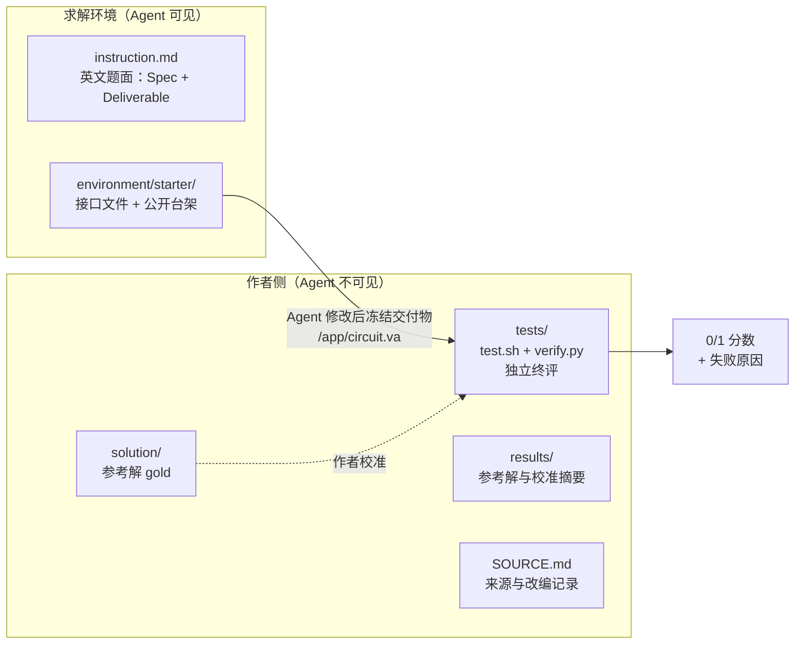
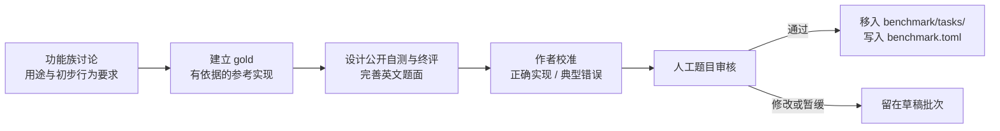

# Benchmark：构成方式

这个 benchmark 评估**大模型和智能体能不能用 Verilog-A（VA）完成电路工程任务**。每道题给出一项具体的电路工作，例如按规格写一个采样保持模型、修好一个复位逻辑出错的 PFD、给一个真实 POR 电路写测试台。求解者交付 VA 代码，由独立的 checker 在仿真中验收。

本页说明题目怎样组织、一个题包里有什么、怎样验收和评分。当前有哪些草稿题见[预览版本](preview.md)。

!!! warning "正式题集目前为空"
    [正式清单 `benchmark.toml`](repo:benchmark/tasks/benchmark.toml) 里还没有任何题目（`tasks = []`，`state = "draft"`）。下文描述的是已确认的建设规则；规则写进文档，不代表已有题目按它完成审核。

## 评估什么，为什么需要它

评估对象是 [VA 工程任务](repo:GLOSSARY.md#va-工程任务)：以 Verilog-A 为建模或验证手段、有明确工程目标、交付物可以验收的任务。写一段代码可以是其中一步，但是否完成要看规定的电路行为。纯代码理解和技术问答不作为题目。

当前范围是[电压域行为模型](repo:GLOSSARY.md#电压域行为模型)：候选用电压关系、时间演化和离散状态描述行为，不要求实现端口电流、输出阻抗和负载耦合。验收环境本身可以含晶体管电路。

仓库 README 把 benchmark 的价值归为三点。下表把它们对应到具体做法：

| 目标 | 含义 | 具体做法 |
| --- | --- | --- |
| 工程价值 | 题目对应工程师真实要做的工作 | 先说明使用场景、信号路径和要保证的电路行为。通用数学题配上一个电路名称不算成立 |
| 可信评分 | 成绩能说明交付物是否满足要求 | 每题都有独立 checker。编译通过、某个仿真器的一次输出、和参考源码相似，都不能当作正确答案 |
| 区分能力 | 成绩能区分不同模型和智能体 | 保留少量容易但重要的基础题；核心挑战题要在合理交互预算下仍有区分度。难度由试跑判断，一次失败或代码长不能证明困难 |

当前不出仿真加速、收敛和异常耗时类题目；不按文件数、代码长度或预估难度给题目加权。

## 题目怎么组织

### 主分类：五类工程动作

主分类看**求解者要完成什么工程动作**。一个交付物可能包含多项工作，按主要验收目标记一个主类。

| 工程动作 | 给定材料 → 交付物 | 例子（均为草稿题） |
| --- | --- | --- |
| 按规格构建模型 | 接口、行为规格、必要的工程 → VA 模块或系统 | [Alexander BBPD](repo:benchmark/material/draftbench/batches/v2-01/tasks/v2-spec-001-bang-bang-phase-detector/instruction.md)：按规定的内部三点采样和历史对齐写判相器；验收思路是从 data 和 clk 输入独立重建样本组，检查判相方向和输出时序 |
| 从数据建立模型 | 电路表征记录、实验条件、预测要求 → 能预测新实验的 VA 模型 | [真实采样级动态辨识](repo:benchmark/material/draftbench/batches/v2-01/tasks/v2-data-sampling-identification/instruction.md)：给出 SKY130 晶体管采样级的 ngspice 表征（32 条训练实验、2 条自测实验）；终评用 4 条未公开的完整实验比较误差 |
| 扩展与集成 | 可用部件或健康工程、新目标、修改范围 → 新能力或完成连接的系统 | [ADPLL fine TDC 集成](repo:benchmark/material/draftbench/batches/v2-01/tasks/v2-integrate-case0007-adpll-fine-tdc/instruction.md)：在健康的粗调 ADPLL 里接入 fine TDC 和跟踪控制；checker 要看到新测相路径真正改变了 DCO，只输出一个正确的 lock 信号不够 |
| 诊断与修复 | 有故障的工程、正常要求、现象 → 修复后的指定模块或工程 | [PFD 复位修复](repo:benchmark/material/draftbench/batches/v2-01/tasks/v2-repair-pfd-reset/instruction.md)：修复复位与挂起事件取消的错误；允许整体重写，但故障要消失，其他规定行为也要保持 |
| 电路测试与表征 | 固定 DUT 或观测、实验目标、指标定义 → VA 激励、测试台、测量或检查模块 | [真实 POR 测试台](repo:benchmark/material/draftbench/batches/v2-01/tasks/v2-test-por-sequence/instruction.md)：对只读的真实 POR 电路施加上电、欠压、恢复，报告响应时间、周期和脉宽。DUT 有故障时，如实报告 `ok=0` 也算通过 |

五类不要求题量相等，空类别不为凑数出题。每类的输入、交付和验收边界见 [任务类型](repo:benchmark/material/draftbench/docs/task-types.md)。

### 其他维度分别记录

下面这些维度不进入主分类，单独记录，用于分析成绩和覆盖：

| 维度 | 取值 | 说明 |
| --- | --- | --- |
| 电路功能 | 草稿题按 10 个功能组归组，审核编号 R01–R10，例如 R01 采样与多通道读出、R04 PLL 与时钟 | 见 [`tasks.json`](repo:benchmark/material/draftbench/tasks.json)。早期设计卡另用 [`catalog.json`](repo:benchmark/material/draftbench/catalog.json) 中的 6 个电路家族 |
| 上下文层次 | 单个工作单元、有边界的小工程、完整仓库任务 | 给了多个文件不等于系统任务；要求改多个文件也不等于更难 |
| 来源 | 真实工程问题、合理的人工故障、依据明确工程需求的原创 | 人工故障要说明发生机制。数据要分清晶体管仿真、硅片实测和行为合成 |
| 交互设置 | 主评测是 [Agentic 评测](repo:GLOSSARY.md#agentic-评测)，[One-shot 评测](repo:GLOSSARY.md#one-shot-评测)作对照 | Agentic：在预算内读材料、跑仿真、看反馈、改交付物。两种权限的结果不能混为同一条件 |
| 同源关系 | 题目的 `source_group` | 同一电路可以出多道题；统计时保留关联，不把变体当成多个独立电路 |

依据见[选题参考：上下文、来源与题数](repo:benchmark/material/draftbench/docs/design-reference.md#上下文来源与题数分别记录)。

### 两条电路路线

路线说明行为依据和工程环境，与五类工程动作分开记录。同一功能族可以两条路线都有。

| 路线 | 典型材料与工作 | 审核时额外看什么 | 例子 |
| --- | --- | --- | --- |
| 真实电路结合 | 基于有来源的器件电路建模、开发表征仪器，或让 VA 部件与器件电路协作 | 来源版本、工况和观测是否可信；目标现象是否真实存在；数据是否足以支撑任务 | 真实采样级动态辨识：数据来自 SKY130 晶体管电路的 ngspice 表征（`data_provenance = "transistor_simulation"`） |
| 全 Verilog-A | 用 VA 行为模型组成模块、系统和测试环境 | 假设与适用范围是否清楚；状态、动态和模块协作是否体现目标电路工作 | [R01 理想跟踪保持](repo:benchmark/material/draftbench/batches/r01-sampling-01/tasks/r01-spec-ideal/README.md)（`circuit_route = "all-va"`） |

v2/v3 旧题包的 `task.toml` 没有路线字段，上表“真实电路结合”的例子是按路线定义归类的；R01 两题记为全 VA。

两点容易误解：全 VA 不等于 EVAS 已经兼容；真实电路结合也不等于必须用 Spectre。后端按题选择和验证。详见[区分两条电路路线](repo:benchmark/material/draftbench/docs/design-reference.md#区分两条电路路线)。

本阶段的安排是：全 VA 题推进到完整题包和首轮模型解题实测；真实电路结合题先写出英文 instruction 与 gold，暂不实际测试（见 [R01 本阶段安排](repo:benchmark/material/draftbench/DISCUSSION.md#r01-本阶段安排)）。

## 一个题包里有什么

题包采用 [Harbor 任务格式](https://docs.harborframework.com/tasks/overview)。题面、公开起始工程、参考解、checker 和作者结果放在同一个题包里；checker 随题保存，不依赖仓库外层的评分源码。

| 部分 | 位置 | 内容 | 求解者能看到吗 |
| --- | --- | --- | --- |
| 题面 | `instruction.md` | 英文，分 `Spec`（行为、合法范围、验收尺度）和 `Deliverable`（编辑路径、接口、交付限制、公开测试入口）两段 | 能 |
| 配置 | `task.toml` | Harbor 配置、交付物声明（如 `artifacts = ["/app/circuit.va"]`）、元数据（工程动作、来源组、后端、阶段、审核状态） | —（运行配置，不是解题材料） |
| 运行环境 | `environment/` | `Dockerfile` 与 `starter/`；`starter/` 进入环境后成为 `/app/`，含接口文件和公开台架 | 能（`starter/` 部分） |
| 参考解 | `solution/` | gold 实现与 `solve.sh`。gold 用来证明题目可完成，不是唯一正确答案 | 不能 |
| 验收 | `tests/` | `test.sh` 是评分入口，`verify.py` 执行独立验收；按需有台架和作者校准样本 | 不能 |
| 作者结果 | `results/` | `reference.json`（参考解结果）、`calibration.json`（checker 正确与错误对照的校准摘要） | 不能 |
| 来源记录 | `SOURCE.md` | 来源、改编、建模选择、待定项和人工审核记录；本项目自己的记录，不是 Harbor 要求 | 不能 |

单文件题的求解者直接编辑 `/app/circuit.va`，最后收集同一个文件。多文件工程在 `/app/` 原位修改，默认逐文件声明交付范围，确有需要才开放指定目录。完整约定见[题包约定](repo:benchmark/material/draftbench/docs/task-package.md#任务结构)。

!!! note "草稿题包还没有统一到这个格式"
    上面是已确认的目标规范。现有 56 道旧题包仍用原来的工程合同，题面使用 `/work/` 路径；只有 R01 两题按新规范编写。

## 怎么验收和评分

### gold 通过不等于题目合格

参考解跑通，只说明这道题存在可行解。题目要合格，还需要证明：

- **其他正确实现也能通过。** checker 不能只认作者那份代码的状态变量、事件组织或输出顺序。
- **典型错误会被检出。** 例如有限采集采样保持题，要检出“瞬时采样”“每个窗口清零”“固定时间常数”“瞬时复位”“保持期漏电”这几类错误。
- **绕过目标的做法会被检出。** 例如 SAR 前端题，如果直接把外部模拟输入量化成数字码，即使最终输出接近，也没有完成保留内部架构的任务；ADPLL 题禁止读取固定激励或预计算结果来绕开 TDC 和控制器。

错误版本因为编译失败或后端出错而得 0 分，不算 checker 检出了这个错误；只有完成测量、再因违反对应判据被拒绝，才算检出。作者用来做这些检查的实现叫[校准样本](repo:GLOSSARY.md#校准样本)，不计入题量。

### checker 怎么设计

- 预期结果来自公开规格、独立推导、独立波形分析，或数据建模题的留出实验。gold 的输出不能当作唯一真值。
- 隐藏测试只检查公开合同里写明的要求，不增加隐藏要求。
- **公开自测**给求解者调试用；**独立终评**在提交后、在独立环境中从冻结交付物重新执行，不读求解者留下的 PASS 标记或结果文件。范围型任务的终评会用未参与调试的新实例。
- 结果按 `Specification | Limit | Value | Pass/Fail` 呈现。

详见[逐题 checker 与终评设计](repo:benchmark/material/draftbench/docs/evaluation.md#逐题-checker-与终评设计)和[独立判据与校准](repo:benchmark/material/draftbench/docs/evaluation.md#独立判据与校准覆盖什么)。

### 计分

- 主成绩是**任务级 0/1**：满足全部必需要求记 1，否则记 0。不按测试用例数或正确采样点比例给部分分。例如有限采集题复位错误，即使绝大多数采样点正确，也记 0。
- 已执行但失败的尝试（编译失败、超时、波形缺失、数值超差等）都记 0，失败原因单独记录。
- 后端或基础设施导致的失败也记 0 并保留原因，但不能据此认定候选的 VA 行为错误。尚未执行的题没有成绩，不补 0。
- 环境缺陷如果影响了 Agent 收到的反馈，修复后重跑；只影响终评的，对冻结提交重新评分。

规则来源：[任务分数与失败原因](repo:benchmark/material/draftbench/docs/evaluation.md#任务分数与失败原因)。

### 验收后端按题固定

每道题固定解题和评分用的仿真后端、工具链版本和数值设置。不同题可以按需要分别用 EVAS、ngspice 或 Spectre，同一道题内 Agent 不能自己切换仿真器。

- 在已验证的 ngspice 支持范围内、有可信独立 checker 的题，可以由 ngspice 独立给出正式成绩，不强制经过 Spectre。
- 用 Spectre 验收的题照样执行声明的协议，EVAS 通过不能替代。
- 正确的 VA 因后端能力不足而无法执行，属于环境缺陷，不算候选错误，也不自动算通过。
- 正式发布时分两组报告：不依赖商业工具即可重新验收的**公开主集**，和仍依赖 Spectre 的 **Spectre 扩展集**。

详见[每题固定后端](repo:benchmark/material/draftbench/docs/evaluation.md#每题固定后端设计时处理能力差异)。

### 人工审核原则

自动检查和作者校准不能代替人工认可。人工审核看四个问题（[审核原则](repo:benchmark/material/draftbench/docs/design.md#人工如何判断题目质量)）：

1. **工作有价值**：使用场景和交付物明确，能说明工程师为什么需要做这项工作。
2. **电路行为合理**：保留关键状态、动态与协作；模型假设和适用范围有依据，时序与验收边界说清楚。
3. **材料与验收可信**：公开材料说清决定正确性的行为；验收接受不同正确方案，并检出典型错误和绕过目标的做法。
4. **贡献清楚**：说明相比已有题新增了什么。基础题可以保留；内容质量和运行成熟度分开报告。

### 从草稿到正式题

草稿按批次放在 `benchmark/material/draftbench/batches/<批次>/tasks/`。一道题通过审核后，移到 `benchmark/tasks/<题号>/`，在 `task.toml` 记 `review_status = "accepted"`，并加入 `benchmark.toml`；同批其他题不受影响。合入 main、有参考解或跑通过仿真，都不等于录取。见[建设流程](repo:benchmark/material/draftbench/docs/evaluation.md#建设流程与完成标准)和[批次管理](repo:benchmark/material/draftbench/docs/evaluation.md#按批次管理与逐题录取)。

## 和历史 vaBench 的关系

本 benchmark 会复用历史 vaBench 的电路和题目素材（例如不少草稿题来自 vaBench v4），但重新核对规格、来源和 checker，不继承旧的认证和成绩；历史版本见 [Reference](../reference/index.md)。

## 来源

本页内容整理自 main 上的以下文档：

- [仓库 README](repo:README.md#benchmark) 与 [benchmark 入口](repo:benchmark/README.md)
- [审核原则](repo:benchmark/material/draftbench/docs/design.md)、[选题参考](repo:benchmark/material/draftbench/docs/design-reference.md)、[任务类型](repo:benchmark/material/draftbench/docs/task-types.md)
- [题包约定](repo:benchmark/material/draftbench/docs/task-package.md)、[评测与复现原则](repo:benchmark/material/draftbench/docs/evaluation.md)
- [共同术语](repo:GLOSSARY.md)、[草稿题包总览](repo:benchmark/material/draftbench/TASKS.md)
