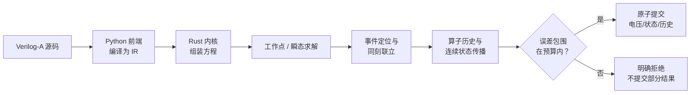

# EVAS 数学原理（导读）

!!! note "本页与完整手册的关系"
    本页是 EVAS 数学手册的导读，面向第一次接触 EVAS 的读者。完整手册在[数学原理章节](manual/math/README.md)，
    由 `solving.md`、`events.md`、`operators.md`、`continuous.md` 四章组成，原文写给维护者，含实现入口、测试和交付状态。
    本页只讲主线和保证的边界，省略了大部分准入细节。**两者有分歧时，以完整手册为准。**
    手册中标为“本地候选”“分支候选”“分支已验收，未合并”的小节不是已交付能力，本页不把它们当作支持范围；
    当前支持状态见[四后端支持范围](repo:evas/docs/COMPARISON.md)。

## 一句话概括

EVAS 把 Verilog-A 的电压贡献汇总成方程，在每个需要的时刻求解；遇到事件和有历史的算子时，先在候选帧里试算，
再把输入、历史、事件时刻和运算的误差一路传到节点电压。**在受支持的瞬态路径上，只有能证明误差在预算内的结果才提交；不能证明时明确报错，
不返回未经认证的波形。**（静态 `solve` 只有局部 Newton 验收，见第 8 节末尾的边界。）手册以 Spectre 为例说明：这类仿真器的收敛判据和截断误差控制是局部控制参数，不是到真解距离的证明（见第 8 节）；
这一差别也是 EVAS 会“拒绝”一些别的仿真器能跑完的模型的原因。

下文用两个说明用的小例子贯穿（不是手册里的测试用例）：

- **三输入求和**：`V(y) <+ V(a) + V(b) + V(c);`，a、b、c 是外部 PWL 驱动。
- **阈值比较器**：`@(cross(V(in) - 0.5, +1)) q = 1;` 加 `V(out) <+ transition(q, 0, 1n);`，in 是一条上升斜坡。

## 章节速览

| 章节 | 解决什么问题 | 给出什么保证 | 不保证什么 |
| --- | --- | --- | --- |
| [solving.md](manual/math/solving.md) | 贡献 → 方程；线性/非线性求解；工作点验收；精度控制 | 原支路残差、行尺度残差、完整 Newton 修正量三项验收；受支持的瞬态路径另有根盒或仿射前向误差认证 | 解的全局唯一性；静态 `solve` 的前向误差界；任意非线性网络收敛 |
| [events.md](manual/math/events.md) | cross/timer 定位；同刻顺序赋值与联立；写者冲突；步长请求 | 事件时刻有根盒或时钟证书；同刻状态和电压经区间认证后整批提交 | 与其他仿真器逐点相同的触发时刻；任意事件组合 |
| [operators.md](manual/math/operators.md) | transition、absdelay、slew、idt、idtmod 的公式、历史和误差 | 成功计算点相对编译后 IR 与原 binary64 源的保守误差认证 | 源码常量折叠误差；名义事件相位偏差；连续时间全轨迹精度 |
| [continuous.md](manual/math/continuous.md) | 积分反馈、高阶滤波、`ddt`、index-one DAE、事件后续算、动态 cross | 线性路径解析传播；非线性路径 Picard 管 + Taylor 余项；最终电压前向误差验收 | 高指标/奇异 DAE；多解时的全局分支选择；一般事件与 DAE 组合 |

## 1. 从电压贡献到方程

EVAS 是电压域仿真器：未知量是节点电压，没有电流未知量。每条贡献保存为一条原关系

$$
F_i(v;u) = \mathrm{lhs}_i - \mathrm{rhs}_i = 0,
$$

其中 $u$ 是固定驱动（外部 PWL 源），$v$ 是未知节点电压。同一支路的多条贡献先按方向累加；参考节点和实例连线参与方程，
**不按模块声明顺序赋值**。

如果所有关系都是仿射的，就组装成

$$
A\,v = b(u).
$$

三输入求和只有一个未知量，$F(y;a,b,c) = y-(a+b+c)$，即 $A=[1]$、$b(u)=a+b+c$。

- 求解：行缩放、部分主元的稠密或稀疏 LU。$A$ 固定时分解只做一次，之后每个样本只换右端 $b$。
- 验收：解出来后仍逐条检查原支路残差，冗余方程也参与检查；欠定或数值秩不足时明确失败。
- 残差没过时，最多做两次迭代精化 $r=b-Ax$、$A\,\delta=r$、$x\leftarrow x+\delta$。手册强调这仍是有限精度计算，
  **不是前向误差证明**，也不能修复奇异或病态问题。

[完整推导](manual/math/solving.md#数学对象) ·
[线性关系与缓存](manual/math/solving.md#线性关系与缓存) ·
[迭代精化](manual/math/solving.md#残差失败后的迭代精化)

## 2. 非线性方程：Newton、阻尼与工作点验收

含多项式项时，关系写成 $F(v;u)=0$，用解析链式法则算 Jacobian $J_{ij}=\partial F_i/\partial v_j$，每轮解

$$
J(v_k)\,\Delta v = -F(v_k),\qquad v_{k+1} = v_k + \lambda\,\Delta v .
$$

阻尼 $\lambda$ 用来找能让残差下降的试步：最多 80 次更新，每次最多 32 次试步，失败则步长减半。
成功返回必须**同时**满足三条（$s_i$ 是该行 Jacobian 的最大绝对值）：

1. 伏特残差：$\lvert F_i\rvert \le B_i$，$B_i = \mathrm{vabstol} + \mathrm{reltol}\cdot\max(\lvert\mathrm{lhs}_i\rvert,\lvert\mathrm{rhs}_i\rvert)$；
2. 行尺度残差：$\lvert F_i\rvert / s_i \le B_i$，防止小增益的矛盾方程被放行；
3. **未经阻尼缩小的完整修正量**：$\lvert\Delta V_j\rvert \le \mathrm{vabstol} + \mathrm{reltol}\cdot\lvert V_j\rvert$，避免把“步长很小”误当成收敛。

默认 $\mathrm{vabstol}=10^{-12}\,\mathrm{V}$、$\mathrm{reltol}=10^{-10}$；过严时返回失败，不自动放宽。

Newton 失败（`nonconvergence` 或 `singular_jacobian`）时，小型方阵可以尝试**残差连续化**：
构造 $H_i(v,\lambda)=(1-\lambda)\,\sigma_i(v_j-a_j)+\lambda\,F_i(v)/s_i$，让 $\lambda$ 从 0 走到 1。
例如 $x^3-2x+2=0$ 从零初猜可能停滞，$x^3-1=0$ 在零点 Jacobian 为零。到达 $\lambda=1$ 后必须用原方程、原容差重新验收；
它只是**找初猜的启发式**，不证明根分支连续或全局唯一。

!!! warning "手册写明的限制"
    这是局部数值方法：小残差不证明解唯一，也不直接给出病态问题的电压前向误差界。
    静态求解每个样本从全零初猜开始，不保证收敛到所有存在的根；多解分支选择和奇异根不在验收范围。

[完整推导](manual/math/solving.md#newton-更新与收敛) ·
[连续化重试](manual/math/solving.md#有界残差连续化重试) ·
[容差与失败](manual/math/solving.md#容差与失败)

## 3. 瞬态推进：输出点不定义历史

瞬态请求给出连续的 PWL 驱动、严格递增的 `output_times`、`stop` 和 `max_step`。几个基本约定：

- **`output_times` 只是查询时刻。** 历史由源拐点、事件、算子到期和边沿端点等“语义断点”决定；加密查询不应改变已接受的历史。
- **候选帧与原子提交。** 每次推进先在已接受帧的副本上试算；电压、状态、历史、日程和输出记录全部验收后才一起提交。
  任何样本失败都使整个请求失败，不输出部分成功波形。
- **步长上限。** 模型里的 `$bound_step(h)` 与请求参数 `max_step` 取最小值：设活动请求的认证区间为 $H_j=[L_j,U_j]$，
  下一步 $h=\min(\mathrm{max\_step},L_1,\dots,L_n)$，再服从更早的源拐点和事件边界。取下界保证不超过任何可能的请求值。

对无状态、无事件、无历史算子的多项式瞬态，EVAS 在每个输出点先按 binary64 代表输入求名义解，
再用**包含原始 PWL 精确插值的输入区间** $U$ 重放原关系，并要求根盒证书。单未知量先用中值定理：若 $J(X,U)$ 不含零，
令 $m=\inf\lvert\partial F/\partial v\rvert$，当 $\sup\lvert F(x,U)\rvert/m$ 严格小于到预算盒 $X$ 两端的距离时，
证明每个固定输入在盒内恰有一根。不能证明时改用 Krawczyk 算子

$$
K = x - C\,F(x,U) + \bigl(I - C\,J(X,U)\bigr)(X - x),
$$

只有 $K$ 严格内含 $X$ 且 $\lVert I - C\,J(X,U)\rVert_\infty < 1$ 时才接受（$C$ 只是浮点预条件器）。

两种证明都失败时返回 `waveform_accuracy`，**不静默接受名义残差为零的点解**。纯仿射模型（如三输入求和）不走 Krawczyk，
而是用原 IR 的仿射前向误差映射，把 PWL 插值和方程运算误差传到节点电压。

!!! example "手册里的已修复反例"
    源 $(0,1),(3,2)$ 在 $t=1$ 的精确插值是 $4/3$。关系 $y=10^{16}(u-1)$ 曾返回 $3333333333333334\,\mathrm{V}$，
    误差约 $2/3\,\mathrm{V}$，却通过了 $\mathrm{vabstol}=10^{-12}$ 的名义残差门。现在由仿射误差映射或根盒拒绝。
    另一个例子 $y=u+y^2$、$u=0.25$：名义残差和修正量都可舍入到零，返回值却离精确重根 $0.5$ 约 $3.7\times10^{-9}\,\mathrm{V}$；
    现在重根和不能证明的近重根都明确拒绝。

[根盒证明](manual/math/solving.md#非线性瞬态的根盒) ·
[已修复反例](manual/math/solving.md#精度链的已修复反例与边界) ·
[步长请求](manual/math/events.md#bound-step)

## 4. 事件定位：cross 与 timer

手册区分三个时间对象：数学根 $\tau$、实际触发 $t_e$、内部代表时刻 $b$。它们不能混用。

**cross（仿射 guard）。** 在一段 PWL 上，固定状态的仿射网络给出 $g(t)=g_a+m\,(t-t_a)$。若 $m\neq0$，候选根

$$
t^* = t_a - \frac{g_a}{m},
$$

还要验证段内位置、方向和误差界。比较器例子里，$g(t)=V_{in}(t)-0.5$，方向 $+1$ 只接受上升穿越。
`ttol` / `tol` 缺省为 1 ps 和 $10^{-9}$（表达式单位）。LRM 要求事件发生在穿越之后、时间与表达式容差窗口之内；
对斜率为 $m$ 的局部线性 guard，允许的延后为 $\min(\mathrm{ttol},\,\mathrm{tol}/\lvert m\rvert)$。
根盒 $[lo,hi]$ 的代表时刻取上界 $hi$。

直接驱动输入的根还可以用精确有理数证明先后。例如 $u$ 在 6 µs 内从 0 升到 3 V，`cross(u-0.7,+1)` 的数学根
比 binary64 查询点 $1.4\times10^{-6}$ 晚约 $10^{-23}$ s，两者舍入到同一个浮点数；端点区间运算无法判断查询读前态还是后态，
原输入的有理证书可以。

**cross（非线性 guard）。** 对每段建立值包围 $g(I)$ 和导数包围 $g'(I)$：$0\notin g(I)$ 则无根；导数严格同号且端点异号则唯一穿越，
再二分收缩；不能证明单调就细分。切线、恒零平台、预算耗尽或次序无法证明时返回 `event_resolution`，
**不能静默变成“没有事件”**。

**timer。** 周期事件定义为实数 $t_k=\mathrm{start}+k\cdot\mathrm{period}$，用整数 $k$ 生成，不从上次实际事件累加。
实际候选取包围区间的上界 $s_k$，并须证明 $0\le s_k-t_k\le\mathrm{time\_tol}$。缺省 `time_tol` 为 1 ps，这是 EVAS 的选择，规范没有规定。

**above 等其他分析事件。** 数学手册没有 `above` 的章节；支持矩阵把 `above`、`last_crossing` 列为仍开放的缺口
（[GAP14](repo:evas/docs/COMPARISON.md#gap-14)）。

!!! info "与其他仿真器的触发时刻"
    EVAS 与 Spectre 可以满足同一事件契约，却在容差窗口内选不同的触发时刻；手册中 V3 实验的 Spectre 基础档比数学根晚 250 ps，仍在 500 ps 的允许窗口内。
    这不证明哪一方出错，也不说明 EVAS 普遍更准确。比较时应同时报告独立数学答案、允许的事件历史和实际设置。

[仿射定位](manual/math/events.md#仿射轨迹上的数学定位) · [输入根证书](manual/math/events.md#原始输入的事件时刻证书) · [非线性 guard](manual/math/continuous.md#非线性-guard-的根证明) ·
[固定 timer](manual/math/events.md#固定-timer) · [容差与波形差异](manual/math/events.md#backend-cross-tolerances)

## 5. 同一时刻发生什么：顺序与联立

**同一块内按语句顺序。** `n=n+1; n=n+1;` 对应 $n_1=n^-+1,\ n_2=n_1+1$，净增 2。后一句看到前一句的结果。

**不同块同刻触发时，从同一份事件前状态出发并联立。** 设已接受状态为 $s^-$，各块按顺序构造 $s^+=\Phi(s^-,v^+)$，再解

$$
F\bigl(v^+,\ \Phi(s^-,v^+),\ t\bigr) = 0 .
$$

固定候选算子值后这条路径限定为仿射，可代入后直接解线性方程。之后重放原赋值、检查原电压残差和状态一致性，
再从原 IR 用向外舍入独立重建方程，包围事件后的电压和状态：电压须在 $\mathrm{vabstol}+\mathrm{reltol}\cdot\lvert v\rvert$ 内，
integer 状态必须精确，否则返回 `event_accuracy`。手册写明，同刻电压联立是本实现的选择，不称为所有 Verilog-A 事件的唯一通用语义。

几条规则：

- **写者冲突。** 同一批次里两个不同块写同一状态，返回 `event_conflict`，即使写入值相同，也不按源码顺序仲裁。
  读取另一块在本批写入的状态也拒绝。
- **无解或多解就拒绝。** 例如事件方程要求 $q=y+1$ 且 $y=q$，无解，EVAS 明确拒绝。
- **cross 事件体读根后右极限 $t_e=\tau^+$。** 连续量用 $\tau$ 处的根盒包围；恰为零的条件差值要取根后一侧的符号证书。
  例如 `u=3t, cross(u-1,+1)` 内的 `u>1` 为真。timer 触发的事件体仍在该时刻按点值判断。
- **事件体条件用区间判定。** 谓词差的包围为 $D=[L,H]$：`d>0` 在 $L>0$ 时可证真、$H\le0$ 时可证假，其余三种比较同理；
  包围跨零时，只有两臂行为完全相同才继续，否则返回 `event_condition`，不引入额外 epsilon。
- **OR。** `@(cross(g0) or cross(g1))` 是触发集合的并；只有证明同根才合并为一次执行，相距小于 `ttol` 的不同根也不合并。
- **t=0 的次序。** 先安装 `initial_step` 初值，再求初始电压，再原子执行 `timer(0)`，最后输出初始观测。

[同刻联立](manual/math/events.md#同块顺序赋值与同刻联立求解) · [写者检查](manual/math/events.md#multiple-event-writers) · [根后右极限](manual/math/events.md#cross-right-limit) ·
[事件体条件](manual/math/events.md#event-conditions) · [事件 OR](manual/math/events.md#cross-的事件-or)

## 6. 直接输入算子：历史与误差

算子按“实例 + 源码调用点”保存历史，与用户状态分开。设 $q$ 为离散状态、$H$ 为已接受历史，先求算子值 $z(t;q,H)$，
再代入电压方程 $A\,v=b(u,q,z)$。查询不写历史；每个算子同时保存代表值和向外舍入的区间，区间随后进入同刻认证和电压验收。

| 算子 | 数学形式（直接输入路径） | 误差处理要点 |
| --- | --- | --- |
| `transition(x,d,tr[,tf])` | 延迟 $d$ 后以有限斜率线性过渡；中断时从当前值出发，斜率由历史起点和新目标决定 | 上升段的实数参考值包在 $\max(Y,\min(Q,Y+M([t]-T)))$ 的区间扩展内 |
| `absdelay(u,τ)` | $y(t)=u(\max(t-\tau,0))$ | 查询时间用补偿减法保留低位，再在原拐点上插值 |
| `slew(u,r+,r-)` | 分段解析追赶；交点 $t_c=t_0+(u_0-y_0)/(s-a)$ | 模式和交点次序须可认证，否则失败 |
| `idt(u,ic[,reset])` | 每个 PWL 段 $z(t_0+h)=z_0+a h+(b-a)h^2/(2d)$ | 无积分截断项；浮点运算误差仍用区间包围 |
| `idtmod(u,ic,mod,off)` | $\mathrm{phase}=\mathrm{off}+(z-\mathrm{off})\bmod \mathrm{mod}$，半开区间 | 包围跨 wrap 点时默认给整周期范围，可能返回 `waveform_accuracy` |

几个值得记住的例子（均来自手册）：

- **transition 中断几何。** 2U 时目标从 0 变 1，`tr=10U`；6U 时值为 0.4。若目标改为 0、`tf=20U`，斜率为 $-1/(20U)$，在 14U 到 0。
  不能把剩余边沿重设为完整 `tr/tf`，也不能从旧目标跳变。
- **为什么要包围历史。** 源事件在 $t_e=10^{12}\,\mathrm{s}$、$d=0.10005\,\mathrm{s}$、边沿 1 s 时，旧版在 $t_e+0.5$ 的输出误差约
  $1.7\times10^{-4}\,\mathrm{V}$，却在 $\mathrm{vabstol}=10^{-9}$ 下被接受。原因是把已舍入的算子输出当成了精确右端项：
  残差为零只说明方程解对了，不说明历史准确。
- **absdelay 的大时间。** $t=2^{54}+4$、$\tau=3$，在 $2^{54}\to2^{54}+4$ 的 0→1 斜坡上答案是 $1/4$；先舍入 $t-\tau$ 可错误得到 0。
- **idt 的精确性边界。** 对 PWL 输入，分段公式消除了积分截断误差，但**没有**消除浮点运算误差，后者仍须通过电压预算。

比较器例子中，cross 在根盒内触发，`q` 从 0 变 1，transition 在事件后安装新目标。transition 输出在事件时刻连续，
所以同刻可固定当刻值 $z_e$ 联立求解，再核对 $z_e$ 未变，最后连同状态、历史、日程一起提交。

!!! warning "同一算子可能走不同路径"
    手册 README 特别说明：同一算子可经不同路径求解。例如直接 PWL 输入的 `idt` 用上面的解析积分，带反馈的 `idt`
    进入第 7 节的联合连续网络。**不能把单一路径的限制读成整个算子的限制。**
    再如“absdelay、slew、idtmod 的非点事件观察明确拒绝”只在事件时刻是有宽度的根盒时触发（手册注明目前作用于同一模型的
    整个算子向量，可能保守拒绝）；精确时刻事件的原有支持保持不变。

这些历史证书针对成功接受的计算点，参考对象是编译后的 binary64 IR 和原始 binary64 PWL；不包含源码到 IR 的常量舍入、
名义事件相位偏差、物理模型误差，也不是连续时间全轨迹证明。区间相关性丢失可能让实际误差很小的模型被保守拒绝。

[公共执行方法](manual/math/operators.md#公共执行方法) · [transition](manual/math/operators.md#transition) · [历史误差与电压精度](manual/math/operators.md#历史误差与电压精度) ·
[absdelay](manual/math/operators.md#absdelay) · [slew](manual/math/operators.md#slew) · [idt](manual/math/operators.md#idt) · [idtmod](manual/math/operators.md#idtmod-与-sin)

## 7. 联合连续状态与 DAE

当积分有反馈、滤波是高阶、或电压关系是隐式非线性时，算子不能逐个推进，要放进同一个连续系统。

**线性网络。** 同支路贡献累加后写成 $A_v v + A_z z + A_u u + a = 0$，积分状态满足 $z'=B_v v+B_z z+B_u u+b$、$z(0)=\mathrm{ic}$。
代数部分须有唯一可认证解，消去 $v$ 得 $z'=M z+N u+c$。例如 `y=idt(1-y,0)` 给出 $y'=1-y$，解为 $y=1-e^{-t}$。
在一段 PWL 上令增广量 $w=[z,u,m,1]$，则

$$
w' = G\,w,\qquad w(t) = \exp\bigl(G\,(t-t_a)\bigr)\,w(t_a),
$$

矩阵指数用向外舍入的区间 Taylor、缩放与平方计算，并加上尾项界。**线性路径没有时间离散**，输出网格和 `max_step` 不定义积分历史。

**非线性多项式网络。** 积分状态汇集为 $z'=f(z,u,q)$。每个内部试步先找有限状态盒 $Z$，证明 Picard 管

$$
z_0 + [0,h]\cdot f(Z,U) \subset \operatorname{int} Z ,
$$

从而该段唯一有限轨迹留在盒内；再用区间 Taylor 展开加余项 $z(t_0+s)\in P_p(z_0,u_0,m,s)+R\,s^{p+1}$。
显式 ODE 一般依次尝试 $p=6,12,24$（纯源场和隐式 DAE 另有规定），仍不能认证才减半步长。试算预算耗尽时返回 `waveform_accuracy`，
这只说明在工作上限内无法认证，**不表示已证明模型无解**。

**index-one 隐式 DAE。** $z'=f(z,v,u)$、$F(v,z,u)=0$。当 $J_v=\partial F/\partial v$ 在整个轨迹管内可证明非奇异时，对约束求导得

$$
J_v\,v' = -F_z\,f - F_u\,m,\qquad m = u' .
$$

初始根由 Newton 选出、再用区间根证明认证存在和**局部**唯一性；多解时的全局分支选择尚未解决。
例如 `y+y²=z, z'=-1` 在 $t=1/4$ 处 Jacobian 为零，不能越过折叠点继续认证。高指标/奇异 DAE 和一般事件组合仍拒绝。

**事件后续算。** 离散参数 $q$ 在事件间不变。事件后从已接受历史的包围续算，不重新做 DC。若真实事件只知道落在窗口
$W=[a,b]$ 内、代表时刻为 $b$，就要包围“从任一可能的 $\tau$ 用新关系走到 $b$”的整段新流：

$$
X + [0,h]\cdot f_Q\bigl(Z, U(W)\bigr) \subset \operatorname{int} Z,\qquad h=b-a .
$$

其中 $X$ 是旧历史在 $W$ 上的包围再经实际复位映射后的状态。只用 $z(b^-)$ 或只把旧历史当新初值，都会漏掉这段新流。

手册对现有支持路径做过积分误差覆盖核查，结论是**没有发现只按输出点推进、却遗漏积分截断项的路径**；
手册同时写明这不是全语言或连续时间的正式资格证明。

[积分反馈](manual/math/continuous.md#电压关系与积分反馈) · [线性解析传播](manual/math/continuous.md#线性解析传播) · [非线性积分与误差证明](manual/math/continuous.md#多项式非线性积分与误差证明) ·
[index-one DAE](manual/math/continuous.md#index-one-多项式隐式电压-dae) · [事件后续算](manual/math/continuous.md#事件修改的联合积分与复位) · [误差覆盖核查](manual/math/continuous.md#integration-error-audit)

## 8. 精度链：能证明才接受

前面每一节都在做同一件事：把误差来源一路带到最终电压，而不是只在最后检查残差。

源误差（PWL 插值、源误差界）→ 算子历史区间、事件根盒或时钟区间 → 采样状态区间 → 节点电压包围 → 与电压预算比较。

在受支持的瞬态包围路径中，EVAS 检查

$$
\max\bigl(\lvert \hat v - \mathrm{enc.lo}\rvert,\ \lvert \hat v - \mathrm{enc.hi}\rvert\bigr) \le \mathrm{vabstol} + \mathrm{reltol}\cdot\lvert \hat v\rvert ,
$$

误差取向外舍入的上界，预算取下界。real 状态没有物理单位，不单独套电压容差，但必须保留有限误差区间，由后续电压、历史和事件消费者继续认证。

**拒绝是设计的一部分。** 手册在多处写明同一原则，例如：

- 根盒不能证明时返回 `waveform_accuracy`，不静默接受名义残差为零的点解；
- 认证失败即拒绝，不能因数值残差小而绕过，也不能把 LU 成功当作历史误差达标；
- 不得清零历史误差、放宽预算或返回未经认证的波形；连续化重试也没有 `allow_uncertified` 开关；
- 非线性 guard 无法证明时返回 `event_resolution`，不能静默变成“没有事件”。

常见错误码：`waveform_accuracy`（波形精度）、`event_accuracy`（事件后电压/状态精度）、`event_resolution`（事件时刻或次序不能证明）、
`event_condition`（事件体分支不能证明）、`condition_precision`（普通条件真值不能证明）、`event_conflict`（同批写者冲突）。

精度失败时，手册按发生位置给出有限的补救：局部截断项过大时有界升阶、缩步；累计历史包围过大时最多细化重建 8 次后缀；
输入 cross 根过宽时细化根后重试；如果输入、初值或舍入误差本身已超预算，继续缩步未必有效，就拒绝。

!!! info "与点值 + 局部控制的区别（以手册对 Spectre 的说明为例）"
    Spectre 的 Newton 判据约束的是**相邻两次迭代的变化** $\lvert V_{new}-V_{old}\rvert\le\mathrm{vabstol}+\mathrm{reltol}\cdot V_{ref}$，
    其中 $V_{ref}$ 取决于 `relref` 等设置；瞬态另有局部截断误差控制。这些都是局部控制参数，不是到真解的距离，
    也不是整段轨迹的误差证明。EVAS 在受支持路径上包围的是返回值到参考集合的距离。
    因此两后端使用相同的参数名和值，**不表示精度相同**。

!!! warning "保证的边界"
    - EVAS 也有局部的残差和 Newton 收敛检查，**不能概括为所有入口都提供前向误差证书**；静态 `solve` 只有局部 Newton 验收。
    - 认证相对于传输后的原 IR 和给定源定义，不能恢复前端常量折叠损失，不能证明全局多解选择。
    - 认证的是接受的计算点和观察点，不证明样点之间的连续时间全轨迹误差。
    - 区间传播会丢失相关性，可能保守拒绝真实误差很小的模型；没有自动改用高精度运算重算。
    - 对已有解析历史，改变容差可能不改变名义结果，只改变能否通过证书检查。

[Spectre 与 EVAS 的容差含义](manual/math/solving.md#spectre-与-evas-的容差含义) · [精度控制怎么用](manual/math/solving.md#当前精度控制怎么用) ·
[事件的输入/状态认证](manual/math/events.md#pwl-与事件的执行契约) · [README：精度与结果解释](repo:evas/README.md#精度与结果解释)

## 怎么继续读完整手册

- 查某个算子的公式和测试：先看 [operators.md 的按算子查找表](manual/math/operators.md#operator-map)。
- 查积分和滤波怎么保证精度：读 [continuous.md 的积分误差覆盖核查表](manual/math/continuous.md#integration-error-audit)，它把“余项来源 → 历史保存 → 输出验收”列成一张表。
- 手册里的实现入口（`*.rs`、`*.py`）和测试链接指向仓库源码；“本地候选”“分支候选”的小节以手册标注的状态为准，不要当作已交付能力。
