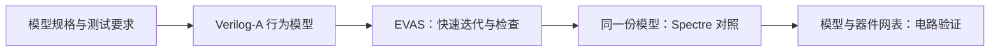

# vaEVAS

vaEVAS 是课题组面向 **Verilog-A 建模与评测**的研究项目，由两部分组成：

- **Benchmark**：用真实的 Verilog-A 工程任务，评估大模型和智能体能不能完成电路建模工作。
- **EVAS**：开源的电压域 Verilog-A 仿真器，让使用者不依赖商业仿真器也能运行和验证目标范围内的模型，也为 benchmark 提供开源复现环境。

两部分各自有使用者、验收标准和交付成果，彼此配合：benchmark 需要可复现的仿真环境，EVAS 需要有代表性的工程模型来证明自己有用。

## 最新阶段

<!-- status-stale -->

状态更新于 **2026-10-22**。每条都标明口径：**已验收**表示有正式收据；**开发中**表示开发过程中的数字，不能当作验收结论引用。

| 方面 | 当前状态 | 口径 |
| --- | --- | --- |
| 阶段目标 | 以 11 月 DAC 投稿为目标，按一篇论文组织 benchmark 与 EVAS 的研究结论；论文用到的题目、工具和实验版本会提前冻结 | 计划 |
| EVAS | [PR208](https://github.com/BucketSran/vaEVAS/pull/208) 已于 2026-10-21 合入 main。400 道原题的开发重放通过 342 道（上一次开发重放为 320），还剩 58 道 | 开发中 |
| EVAS | 最近一次正式检查点（`159c0512`）：318 通过、19 失败、63 拒绝 | 已验收 |
| EVAS | 2026-10-22：用旧版 EVAS 0.8.7 做差分对照，并审计了 checker。Spectre 清单里有 21 道必跑题（审计列出的 20 道，加上 140 的零边沿探针），等待统一运行 | 开发中 |
| Benchmark | [正式清单](repo:benchmark/tasks/benchmark.toml)有 {{ bench_formal }} 题；草稿批次共 {{ bench_drafts }} 个题包（{{ bench_batches }}），完整审核尚未完成（自动读取 main） | 开发中 |
| 进行中的工作 | {{ board_active }} | 自动读取 [项目看板](board.md) |
| 历史资产 | 正在给 vaBench v1–v4 建勘误表，并按来源和任务价值筛选（纯化）；纯化目前只完成了 pilot | 开发中 |

详细记录见[更新日志](changelog/index.md)；所有进行中和计划中的工作见[项目看板](board.md)。

## 许可

!!! warning "许可尚未确定"
    仓库目前没有 LICENSE 文件。在许可确定之前，代码、题目和资料的使用请先联系项目维护者。

许可会分三块分别确定：

| 部分 | 内容 | 状态 |
| --- | --- | --- |
| EVAS 代码 | Python 前端、Rust 内核、测试 | 未定 |
| Benchmark 题目数据 | 题面、参考解、checker、运行环境 | 未定 |
| 历史参考资料 | vaBench 历史包、原始 Verilog-A 源码 | 未定；第三方源码的分发依据尚待确认 |

## 三分钟速览

### 要解决什么问题

工程师用 Verilog-A 写行为模型，例如采样保持、比较器、VCO、滤波器。这类模型需要仿真才能验证，常用的是商业仿真器 Spectre。开源的路线主要有 ngspice + OpenVAF-R 和 Gnucap + modelgen-verilog，可是在事件、定时、积分这类行为上，它们经常编译失败、初始化失败或者漏事件（见 [EVAS 页](evas/index.md)的对比）。

同时，大模型开始被用来写 Verilog-A，但还没有一个可信的工程 benchmark 能说明它们到底能做到哪一步。

### 项目怎么做



- **EVAS** 把 Verilog-A 里的电压贡献转成方程，由 Rust 内核联立求解节点电压，并在事件和时间推进时检查误差。它只做电压域行为模型，不包含晶体管器件模型和电流/电荷方程。原理见[数学原理](evas/math.md)。
- **Benchmark** 按工程动作组织任务（例如写模型、写测试台、修 bug），每题有题面、参考解和 checker，采用 Harbor 任务格式。构成见 [Benchmark](benchmark/index.md)。
- **历史版本** vaBench v1–v4 作为参考资产保留。原件冻结不改，发现的问题记入勘误。见 [Reference](reference/index.md)。

### 三个要知道的数字

| 数字 | 含义 | 不代表什么 |
| --- | --- | --- |
| {{ cmp_evas }} / {{ cmp_total }} | EVAS 在四后端对比表前五节的 {{ cmp_total }} 个用例上的通过数（Spectre {{ cmp_spectre }}，ngspice + OpenVAF-R {{ cmp_ngspice }}，Gnucap + modelgen-verilog {{ cmp_gnucap }}） | 这些用例是本项目按 EVAS 目标范围选的；不代表当前 main 做过一次全量验收，也不说明 EVAS 速度更快 |
| 342 / 400 | 当前 EVAS 在 400 道历史原题上的开发重放通过数 | 不是验收收据；正式检查点是 318 |
| {{ bench_formal }} | benchmark 正式清单里的题数 | 草稿已有 {{ bench_drafts }} 个题包，审核完一题录取一题 |

### 自己试一下

需要 Python 3.10+ 和 Rust/Cargo：

```sh
git clone https://github.com/BucketSran/vaEVAS.git
cd vaEVAS
cargo build --locked --manifest-path evas/rust_core/Cargo.toml
PYTHONPATH=evas/src python3 -m evas solve evas/examples/01-static-gain/sim.json \
  --kernel evas/rust_core/target/debug/evas-kernel
```

这是[第 1 课](repo:evas/examples/01-static-gain/README.md)的三输入求和示例：三条电压贡献相加。输出 JSON 中三组输入的 `out` 电压约为 `0.225 V`、`1.825 V` 和 `-0.325 V`。

## 栏目导航

| 栏目 | 内容 |
| --- | --- |
| [项目看板](board.md) | 想法、设计、排期、进行中、暂停，自动读取 GitHub Issue；当前有 {{ board_alert_count }} 条待处理的提醒 |
| [EVAS](evas/index.md) | 为什么需要 EVAS；和 Spectre、ngspice、Gnucap 的对比（随 main 自动更新） |
| [数学原理](evas/math.md) | EVAS 怎么把 Verilog-A 变成方程并求解，给出什么保证 |
| [Benchmark](benchmark/index.md) | 题目怎么构成；当前预览版 |
| [Reference](reference/index.md) | vaBench 历史版本、已知问题与勘误 |
| [模型成绩榜](leaderboard.md) | 暂空 |
| [更新日志](changelog/index.md) | 每次更新一条，可点进去看详情 |
